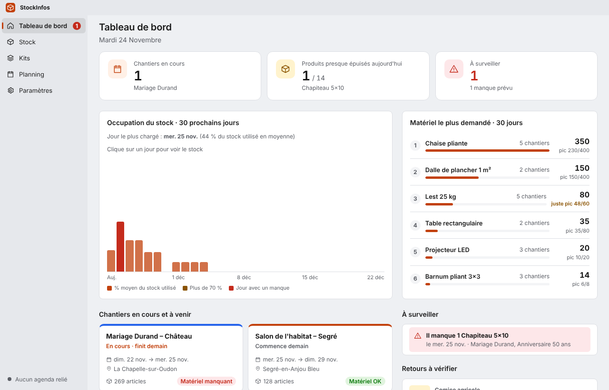
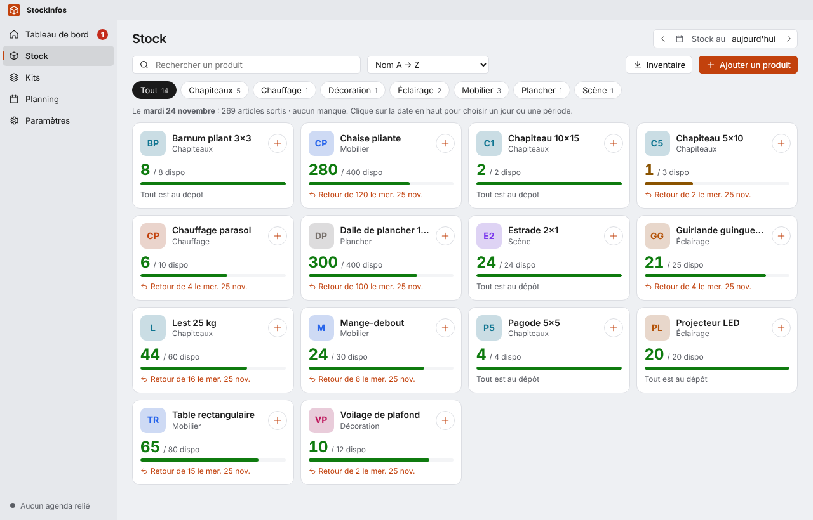

# StockInfos

Application Windows en français pour **gérer son stock**, quelle que soit son activité : matériel de location, outillage, matériel de chantier, équipement d'association, marchandise…

StockInfos dit en un coup d'œil **ce qui est dispo, ce qui est sorti et quand ça revient**, en s'appuyant sur un planning relié à vos agendas.

## Installer

Téléchargez **`StockInfos-Installation.exe`** dans la [dernière version](https://github.com/Weauz/StockInfos/releases/latest), puis double-cliquez dessus.

- Aucun droit administrateur n'est nécessaire.
- Le fichier n'est pas signé numériquement : si Windows affiche « Windows a protégé votre ordinateur », cliquez sur **Informations complémentaires** puis **Exécuter quand même**.
- StockInfos se met ensuite à jour tout seul : quand une nouvelle version est publiée ici, il la télécharge et propose **Redémarrer** (sinon elle s'installe à la fermeture).
- Vos données restent sur votre PC (`%APPDATA%\StockInfos`) et ne sont jamais touchées par une mise à jour.

## Sur téléphone Android

Sur le téléphone, ouvrez la [dernière version](https://github.com/Weauz/StockInfos/releases/latest) et téléchargez **`StockInfos.apk`**, puis ouvrez le fichier.

- Android demande d'autoriser votre navigateur (ou l'appli Fichiers) à **installer des applications inconnues** : acceptez, une seule fois.
- Dans StockInfos sur le PC : Paramètres › Base de données › **QR pour le téléphone**. Sur le téléphone : Paramètres › Base de données › **Scanner le QR code du PC**. Le stock, les chantiers et les inventaires sont alors les mêmes partout.
- L'appli se met ensuite à jour toute seule depuis cette page : quand une nouvelle version sort, elle la télécharge et affiche **Installer** (Android demande juste de confirmer). Vos données sont gardées.

## Ce que fait l'app

**Stock**
- Vos produits en cartes, avec photo (optionnelle), quantité, dispo du jour et date de retour.
- Choix d'un jour ou d'une période dans le calendrier : on voit ce qui reste, en comptant ce qui revient pendant la période.
- Unités de mesure (m², mètre…) : « 5 m² » de plancher = 5 dalles de 1 m².
- Matériel à réparer ou cassé, et les chantiers sur lesquels chaque produit est réservé.
- Import de votre stock depuis un fichier Excel, CSV ou PDF, sans format imposé : les colonnes sont reconnues automatiquement.
- Inventaire (total, hors service, restant, compté) en PDF ou Excel.

**Planning**
- Vues Jour, 4 jours, Semaine, Mois et Liste.
- Synchronisation avec un ou plusieurs agendas Google (ou tout agenda au format iCal).
- Lecture automatique des descriptions : écrivez « 2 tentes, 120 chaises, 30 m² de plancher » dans l'agenda, StockInfos réserve le matériel.
- Alerte rouge quand il manque du matériel, liste de sortie imprimable, contrôle du retour.

**Kits** (optionnels)
- Des groupes de produits qui sortent toujours ensemble, reconnus dans les descriptions, avec le nombre de kits complets possibles.

**Tableau de bord**
- Ce qui est sorti en ce moment, les sorties à venir, le matériel le plus demandé et l'occupation du stock.

| Stock | Planning |
|---|---|
|  |  |
| **Fiche produit** | **Kits** |
|  |  |

StockInfos est fourni « tel quel », sans garantie.
