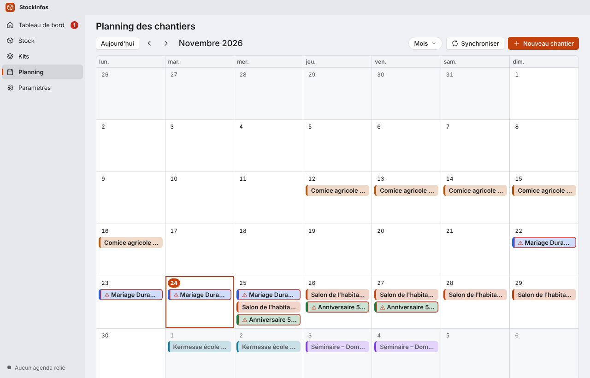

# StockInfos

Gestion de stock et planning de chantiers pour les loueurs de matériel événementiel
(chapiteaux, barnums, mobilier…). Application Windows, libre et open source.


## Ce que fait l'app

**Tableau de bord**
- Chantiers en cours et à venir, avec alerte rouge s'il manque du matériel.
- Matériel le plus demandé et taux d'occupation du stock.

**Stock**
- Produits en cartes avec photo (optionnelle), quantité, dispo du jour et date de retour.
- Tri alphabétique, recherche, ajout direct d'un produit à un chantier (bouton +).
- Choix d'un jour ou d'une période dans le calendrier : on voit ce qui reste,
  en comptant le matériel qui revient pendant la période (« 35 dispo du X au X »).
- Unités de mesure (m², mètre…) avec taille d'une pièce : « 5 m² » de plancher = 5 dalles.
- Matériel hors service / en réparation (avec dates), historique de chaque produit,
  disponibilité sur 14 jours.
- Inventaire : total, hors service, restant, compté — export PDF ou Excel (CSV).

**Planning**
- Vues Jour, 4 jours (par défaut), Semaine, Mois et Liste.
- Synchronisation avec un ou plusieurs agendas Google (adresse iCal secrète),
  choix des agendas affichés et de ceux qui comptent dans le stock.
- Lecture automatique des descriptions : « 2 chapiteaux, 120 chaises, 30 m² de plancher ».
  Les mots inconnus sont signalés, les unités ambiguës se choisissent en un clic.
- Créer un chantier en glissant sur les jours du planning.
- Clic sur un chantier : récap d'abord, puis modification. Liste de chargement imprimable,
  contrôle du retour avec pertes.
- Le matériel est récupéré le jour de la fin et redevient dispo le lendemain.

**Kits** (activables dans les Paramètres)
- Groupes de produits (« Chapiteau réception » = chapiteau + lests + plancher…),
  reconnus dans les descriptions par leur nom ou des mots-clés.
- Nombre de kits complets faisables aujourd'hui et produit qui bloque.

**Paramètres**
- Nom de l'entreprise (demandé au 1er lancement, affiché en haut), agendas,
  thème clair / sombre, sauvegarde et import des données.

| Stock | Planning |
|---|---|
|  |  |
| **Fiche produit** | **Kits** |
|  |  |

**Mises à jour automatiques**
- L'app vérifie au démarrage puis toutes les 4 heures s'il existe une nouvelle version sur GitHub.
- Elle la télécharge en arrière-plan, puis propose « Redémarrer ». Sinon, la mise à jour s'installe à la fermeture.
- Les données ne sont jamais touchées par une mise à jour.

Raccourcis : **Ctrl + K** recherche rapide, **Ctrl + R** recharger, **F12** outils développeur.

---

## Organisation du dossier

```
StockInfos/
├── Lancer.bat            ← double-clic pour lancer l'app (Windows)
├── package.json          ← nom, version, scripts de construction
├── app/                  ← l'application
│   ├── main.js           ← fenêtre Windows, enregistrement, lecture des agendas
│   ├── preload.js        ← pont entre l'interface et Windows
│   ├── icon.png
│   └── renderer/
│       └── index.html    ← toute l'interface et les calculs (un seul fichier)
├── installateur/         ← fichiers pour créer le .exe d'installation
│   ├── installer.nsi
│   ├── after-pack.mjs
│   └── icon.ico, images .bmp
├── docs/captures/        ← captures d'écran
└── moteur/               ← moteur Electron local (non publié sur GitHub)
```

## Lancer l'app (sans installer)

Double-clique sur **Lancer.bat**.
- La 1re fois, il prépare le moteur (environ 1 minute) dans `%LOCALAPPDATA%\StockInfos`.
- Il faut le fichier `moteur/electron-runtime-33.4.11.zip`. Il n'est pas sur GitHub :
  télécharge `electron-v33.4.11-win32-x64.zip` sur la page des versions d'Electron
  et renomme-le `electron-runtime-33.4.11.zip` dans le dossier `moteur`.
- Avec Node.js installé, tu peux aussi faire `npm install` puis `npm start`.

## Modifier l'app

1. Ouvre `app/renderer/index.html` (VS Code ou Bloc-notes), modifie, enregistre.
2. Dans l'app, **Ctrl + R** pour recharger.
3. Si tu modifies `app/main.js` ou `app/preload.js`, ferme l'app et relance **Lancer.bat**.

## Où sont les données

`%APPDATA%\StockInfos\donnees.json`, avec une copie de sécurité chaque jour
(30 jours gardés) dans le sous-dossier `sauvegardes`.
Accès rapide : **Paramètres → Ouvrir le dossier** dans l'app.

## Créer l'installateur .exe

Il faut Node.js et NSIS (makensis).

```
npm install
npm run build
```

Le fichier `dist/StockInfos-Installation-1.0.0.exe` est créé.

## Publier une nouvelle version

1. Change le numéro `version` dans `package.json` (ex. `1.0.1`).
2. `npm run build` pour créer `dist/StockInfos-Installation-1.0.1.exe`.
3. Sur GitHub : **Releases → Draft a new release**, tag `v1.0.1`,
   dépose le fichier `.exe`, puis **Publish release**.
4. Les apps installées se mettent à jour toutes seules dans les heures qui suivent.

Le tag doit être plus grand que la version installée, et la release doit contenir un fichier `.exe`.
