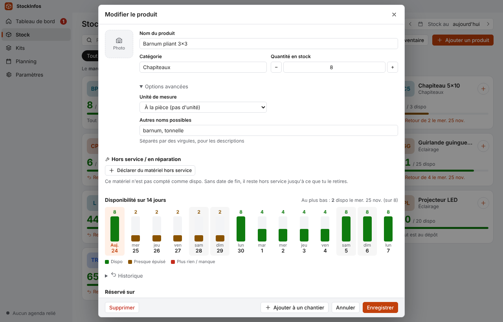
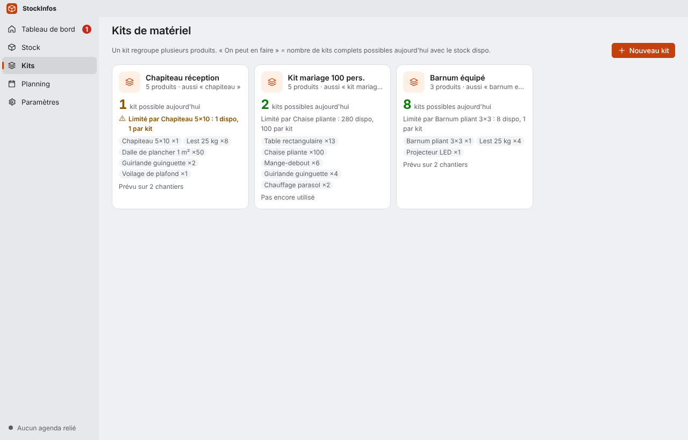

# StockInfos

Application Windows en français pour **gérer son stock**, quelle que soit son activité : matériel de location, outillage, matériel de chantier, équipement d'association, marchandise…

StockInfos dit en un coup d'œil **ce qui est dispo, ce qui est sorti et quand ça revient**, en s'appuyant sur un planning relié à vos agendas.

## Installer

Téléchargez **`StockInfos-Installation.exe`** dans la [dernière version](https://github.com/Weauz/StockInfos/releases/latest), puis double-cliquez dessus.

- Aucun droit administrateur n'est nécessaire.
- Le fichier n'est pas signé numériquement : si Windows affiche « Windows a protégé votre ordinateur », cliquez sur **Informations complémentaires** puis **Exécuter quand même**.
- StockInfos se met ensuite à jour tout seul : quand une nouvelle version est publiée ici, il la télécharge et propose **Redémarrer** (sinon elle s'installe à la fermeture).
- Vos données restent sur votre PC (`%APPDATA%\StockInfos`) et ne sont jamais touchées par une mise à jour.

## Ce que fait l'app

**Stock**
- Vos produits en cartes, avec photo (optionnelle), quantité, dispo du jour et date de retour.
- Choix d'un jour ou d'une période dans le calendrier : on voit ce qui reste, en comptant ce qui revient pendant la période.
- Unités de mesure (m², mètre…) : « 5 m² » de plancher = 5 dalles de 1 m².
- Matériel hors service ou en réparation, historique de chaque produit, disponibilité sur 14 jours.
- Inventaire (total, hors service, restant, compté) en PDF ou Excel.

**Planning**
- Vues Jour, 4 jours, Semaine, Mois et Liste.
- Synchronisation avec un ou plusieurs agendas Google (ou tout agenda au format iCal).
- Lecture automatique des descriptions : écrivez « 2 tentes, 120 chaises, 30 m² de plancher » dans l'agenda, StockInfos réserve le matériel.
- Alerte rouge quand il manque du matériel, liste de sortie imprimable, contrôle du retour.

**Kits** (optionnels)
- Des groupes de produits qui sortent toujours ensemble, reconnus dans les descriptions, avec le nombre de kits complets possibles.

**Tableau de bord**
- Ce qui est sorti en ce moment, les sorties à venir, le matériel le plus demandé et l'occupation du stock.

| Stock | Planning |
|---|---|
|  |  |
| **Fiche produit** | **Kits** |
|  |  |

## Contenu du dépôt

| Dossier | Rôle |
|---|---|
| `app/` | L'application (Electron) : `main.js` pour la fenêtre, les données et les mises à jour, `renderer/index.html` pour toute l'interface |
| `installateur/` | `StockInfos-Installation.exe` : script d'installation (NSIS) et icônes |
| `.github/workflows/` | Fabrique l'installateur et l'ajoute automatiquement à chaque release |
| `docs/captures/` | Captures d'écran |

## Publier une nouvelle version

1. Sur GitHub : **Releases → Draft a new release**.
2. Créez un tag plus grand que le précédent (ex. `v1.0.1`), puis **Publish release**.
3. GitHub fabrique `StockInfos-Installation.exe` (environ 5 minutes) et l'ajoute à la release.
4. Les apps installées se mettent à jour toutes seules dans les heures qui suivent.

Le numéro de version de l'app est pris dans le tag.

## Développement

Avec Node.js : `npm install` puis `npm start`. Après une modification de `app/renderer/index.html`, **Ctrl + R** recharge l'app.

StockInfos est fourni « tel quel », sans garantie.
